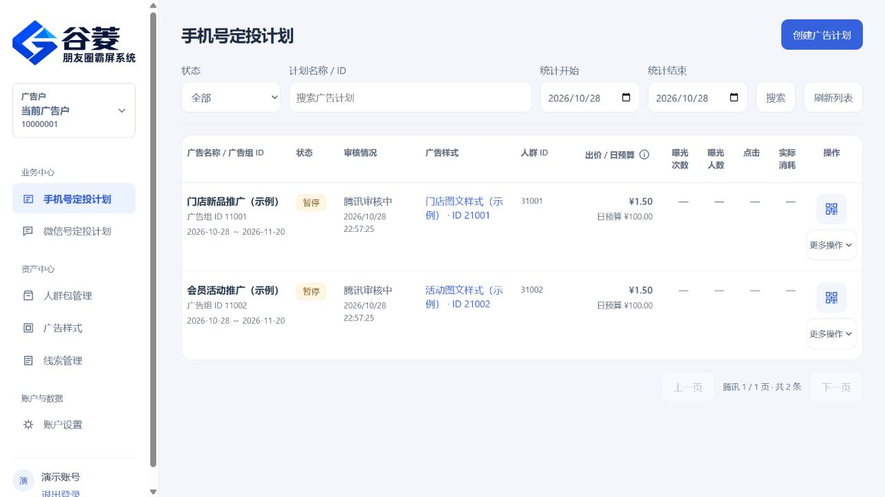
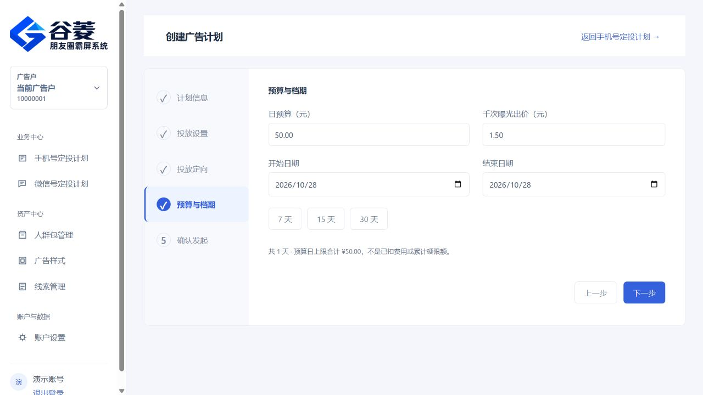
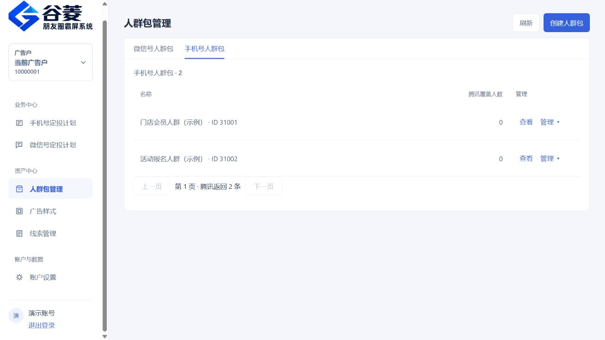
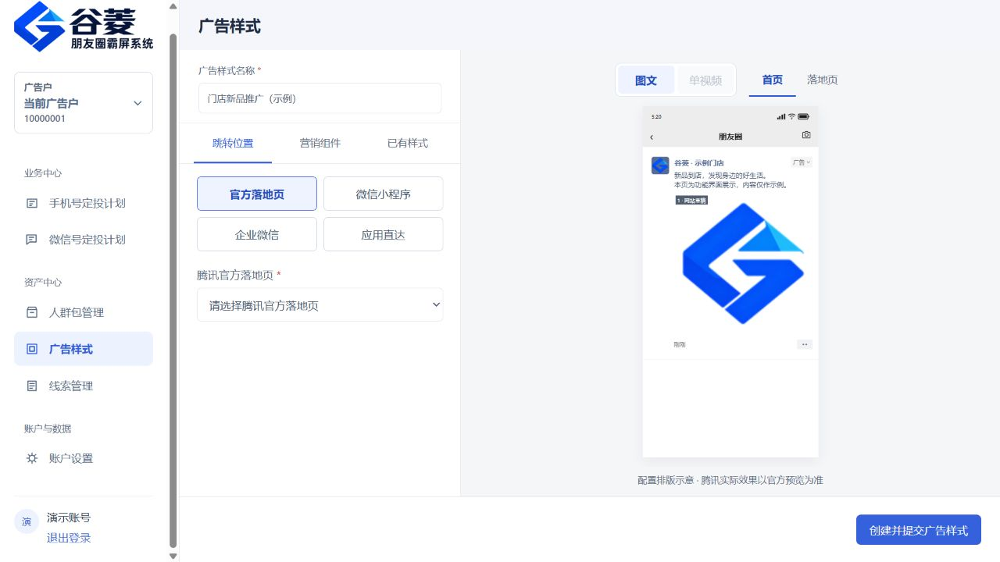
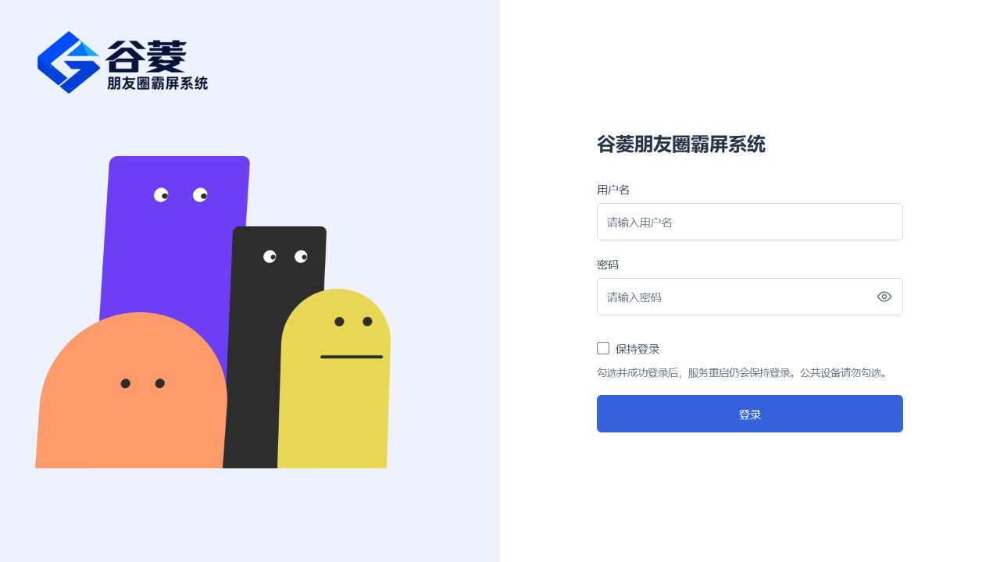

# 腾讯广告｜手机号定向霸屏系统源码

> 谷菱朋友圈霸屏系统：手机号人群包、朋友圈广告计划、多广告户管理、广告样式与线索管理。

**商业源码咨询 · 独立部署 · 正规开户 · 广告代运营 · 代理合作**

批量导入手机号，管理目标人群与广告计划，通过腾讯广告的人群匹配能力开展朋友圈推广。不依赖人工逐个添加微信好友，让客户触达与日常投放管理更高效。

我们拥有 **6 年腾讯广告代运营经验**，可提供正规开户、投放方案定制、广告计划搭建和代理合作服务。源码版本、部署方式及报价，欢迎扫码私聊。

[查看功能介绍](PRODUCT.md) · [了解商业合作](COMMERCIAL.md) · [扫码咨询](#咨询与合作)

## 网站界面展示

以下截图来自当前网站前端，使用隔离示例账号与示例数据，仅展示界面功能，不代表真实客户资料或实际投放结果。

### 手机号定投计划

### 广告计划 · 预算与档期

### 人群包管理

### 广告样式与朋友圈预览

### 网站登录页

## 适用场景

- 门店、本地生活及企业的客户人群运营
- 已有客户、会员等获准使用的号码数据管理
- 多个广告户的日常投放与广告样式管理
- 广告服务商、代运营团队及渠道代理合作
- 希望采用自有系统、独立部署的商业客户

## 核心能力

| 模块 | 能力说明 |
|---|---|
| 手机号人群包 | 号码批量导入、去重、人群包创建与管理，查看平台返回的匹配状态 |
| 手机号定向计划 | 按所选广告户配置广告计划、人群、预算、档期及定向条件 |
| 多广告户管理 | 随当前选择管理对应广告户，保留授权身份与资源归属核对 |
| 广告样式 | 图文、单视频、营销组件、落地页关联及样式预览 |
| 任务与状态 | 查看任务进度、执行记录、平台返回结果与错误原因 |
| 线索与数据 | 查看平台返回的线索、广告状态及相关投放数据 |
| 多角色后台 | 管理员、代理商、客户端等角色分工与账号管理 |
| 商业交付 | 按约定方案提供源码交付、部署对接、更新支持与技术服务 |

**人群匹配与广告展示以腾讯广告实际返回为准。** 实际曝光和转化受账户权限、行业资质、审核、预算、竞价及用户活跃等因素影响。

## 腾讯广告生态推广服务

围绕朋友圈、公众号、小程序、视频号、腾讯新闻等推广场景，提供开户、方案沟通、计划搭建与代运营合作。

当前系统主要展示手机号人群与朋友圈广告管理工作流；其他渠道按具体账户开放资源、系统交付版本和服务方案确认，逐项沟通，按需配置。

## 为什么选择我们

- **6 年实操经验**：从开户、素材准备到计划搭建，结合业务需求沟通投放方案。
- **批量号码管理**：减少重复录入，人群与广告任务集中管理。
- **多户协作**：适合广告服务商与代运营团队的业务分工。
- **商业源码交付**：可沟通独立部署及后续技术支持方案。
- **合作方式灵活**：支持源码咨询、开户、代运营与代理合作。

## 技术栈与环境

| 项目 | 技术与环境 |
|---|---|
| 后端 | Java 17、Spring Boot 3 |
| 前端 | Vue 3、TypeScript、Vite、Pinia |
| 数据库 | MySQL 8 |
| 构建与配套服务 | Node.js 24、npm 11 |
| 部署 | 自有域名、HTTPS 与按交付方案配置的运行环境 |

本仓库是产品宣传展示页。商业源码、安装材料及部署资料通过商务渠道按约定交付，现场部署与账户接入另行验收。

## 咨询与合作

**谷菱网络科技 · 商务王经理**

- 源码、部署与报价：私聊咨询
- 服务：正规开户、投放方案、广告计划搭建、代运营、代理合作
- 扫描下方微信二维码，添加好友请备注 **“腾讯广告源码”**

## 搜索关键词

腾讯广告、手机号定向、朋友圈广告、朋友圈霸屏系统、手机号人群包、客户人群管理、多广告户、广告样式、图文广告、视频广告、营销组件、线索管理、广告代运营、腾讯广告开户、代理合作、商业源码、独立部署、Java 17、Spring Boot、Vue 3、MySQL。

## 仓库说明

公开内容仅包含产品介绍、功能说明、示例界面截图、商业合作说明及商务二维码。商业源码和安装资料通过商务渠道单独交付；客户名单、账号凭据及生产配置留在受保护存储中。具体交付内容以双方确认的方案为准。

本项目为独立商业系统，平台资源及账号使用遵循腾讯广告当前规则。
